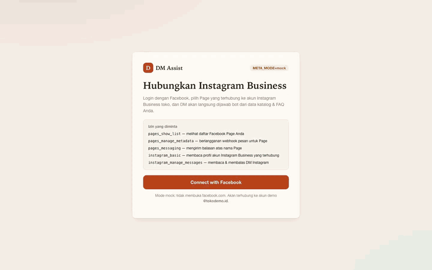
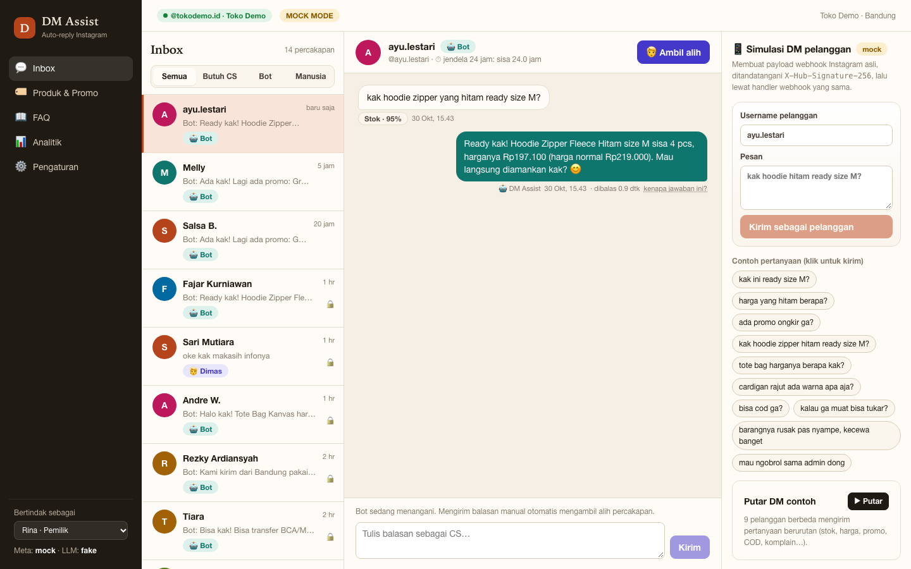
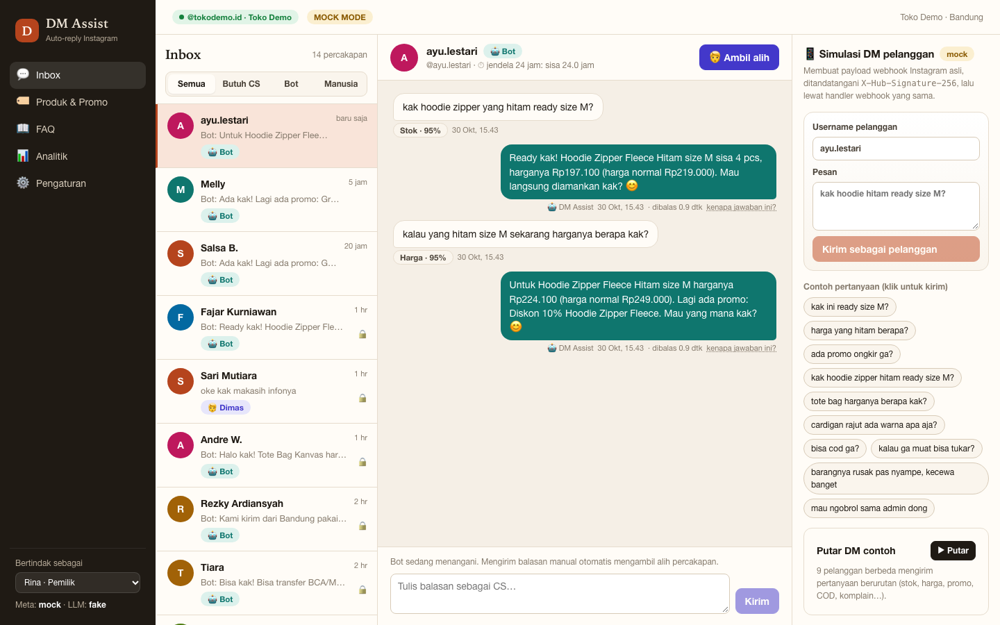
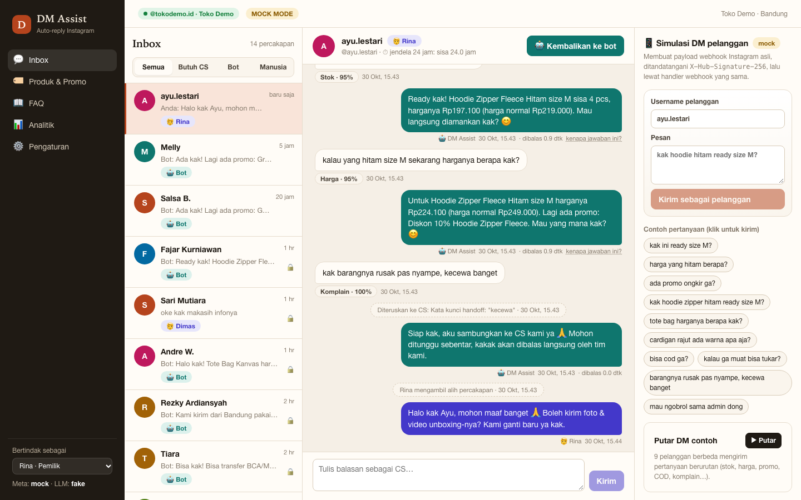
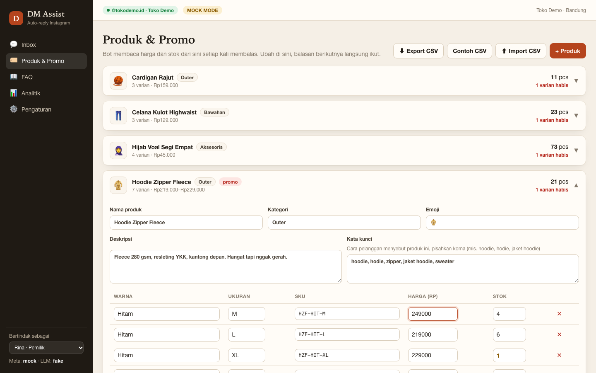
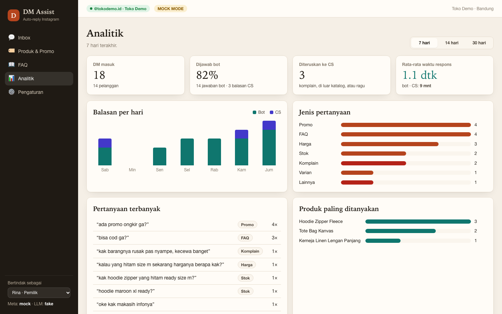
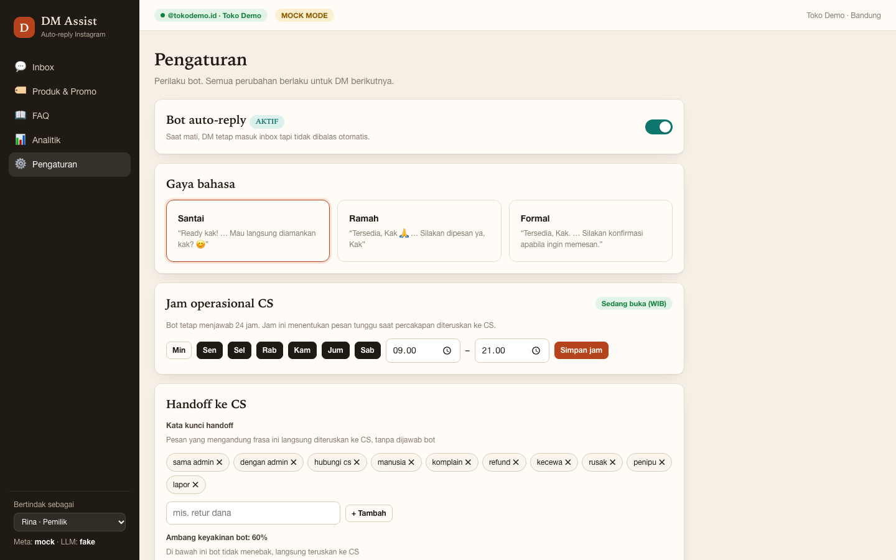

# DM Assist

AI auto-reply for **Instagram Business DMs**, built as a demo for an Indonesian online shop (`@tokodemo.id`).
Customers ask *"kak ini ready size M?"*, and the bot answers in casual-polite Indonesian using **live stock and prices
from the shop's own catalog**. Complaints, unknown questions, or low-confidence messages go to a human CS agent.

The demo runs end to end with **zero credentials** in mock mode, and switches to the real Meta Instagram Messaging API and a real LLM through config.



| Bot answers with live stock | Owner edits price, bot uses it | Complaint goes to a human |
|---|---|---|
|  |  |  |

| Catalog editor | Analytics | Settings |
|---|---|---|
|  |  |  |

---

## 3-minute demo script

Seeded and deterministic in mock mode, so it plays out the same way every time.

| # | Click | What the client sees |
|---|---|---|
| 1 | Open `localhost:3000` → **Connect with Facebook** → **Izinkan & hubungkan** | The Facebook Login flow and requested scopes (mock consent screen), then the inbox, connected as **@tokodemo.id** with a week of history |
| 2 | In the right-hand **Simulasi DM** panel, set username `ayu.lestari` and send **`kak hoodie zipper yang hitam ready size M?`** | A "typing" indicator, then: *"Ready kak! Hoodie Zipper Fleece Hitam size M sisa 4 pcs, harganya Rp197.100 (harga normal Rp219.000)…"*. The stock comes live from the DB and the 10% promo is applied. Click **kenapa jawaban ini?** to show the exact facts the reply was built from |
| 3 | **Produk & Promo** → expand *Hoodie Zipper Fleece* → change *Hitam / M* price to `249000` → **Simpan** | The owner edits the catalog with no deploy and no retraining |
| 4 | Back to **Inbox** → send as `ayu.lestari`: **`kalau yang hitam size M sekarang harganya berapa kak?`** | *"…harganya Rp224.100 (harga normal Rp249.000)…"*. The new price shows up on the very next reply |
| 5 | Send as `ayu.lestari`: **`kak barangnya rusak pas nyampe, kecewa banget`** | The bot doesn't improvise. It sends a holding message, the thread gets a red **Butuh CS** flag, and the sidebar counter goes up |
| 6 | Click **Tangani**, type a reply, **Kirim** | The human agent takes over (badge switches 🤖 → 🧑). **Kembalikan ke bot** hands the thread back to the bot |
| 7 | **Analitik** | Bot vs. human replies, top questions, most-asked products, and average response time (bot ~1s vs. CS minutes) |

Extras worth showing: **▶ Putar** replays 9 seeded customer DMs (stock, price, promo, COD, sold-out size, complaint,
partnership request). **Pengaturan** turns the bot off (DMs still arrive, with no auto-reply) and switches tone between
santai, ramah, and formal. Fajar Kurniawan's thread shows a closed 24-hour window (🔒): the reply box is locked.

---

## How it works

```
Instagram ─► POST /api/webhooks/instagram ─► verify X-Hub-Signature-256 ─► store message (dedupe by mid)
                                                       │                       │ 200 OK to Meta right away
   Simulator (mock) builds the same signed payload ────┘                       ▼  (bot runs in after())
                                                                  ┌──── reply workflow ─────────────────┐
                                                                  │ bot off / human handling? → stop    │
                                                                  │ handoff keyword?          → HANDOFF │
                                                                  │ classify intent (LLM)               │
                                                                  │ complaint / other / low conf → HANDOFF
                                                                  │ tools: product, variants+stock,     │
                                                                  │        promos, FAQ  (live DB read)  │
                                                                  │ template draft from facts           │
                                                                  │ LLM rephrases → NUMBER GUARD        │
                                                                  │ send (24h window enforced)          │
                                                                  └─────────────────────────────────────┘
HANDOFF = flag "Butuh CS", handler=human, holding message (business-hours aware), bot stays silent until given back.
```

**No made-up prices or stock.** The LLM never sources a fact. It has two narrow jobs: label the message (the product id
it returns is checked against the catalog), and rephrase a draft that was built from DB facts. Every number in the
LLM's wording must appear in those facts, or the deterministic draft is sent instead. Each bot message stores its facts
(see *kenapa jawaban ini?*).

**Intents:** `price`, `variant`, `stock`, `promo`, plus `faq` (shipping/payment/returns/hours from the FAQ editor),
`greeting`, `complaint`, and `other`. `faq` and `complaint` go beyond the brief: without `faq`, every COD or shipping
question would hand off, and `complaint` gives handoffs a reason for analytics.

**Context:** a follow-up like *"harga yang hitam berapa?"* uses the product the thread was last about.

**24-hour window:** Meta allows free-form replies only within 24 h of the customer's last message. `send()` refuses
outside it, for both bot and agent, and the UI locks the composer. The demo enforces it in mock mode too, so it's visible.

### Stack

Next.js 16 (App Router, Node runtime) · SQLite · in-process event bus + SSE · Meta Graph API (Facebook Login, Instagram Messaging webhooks) · swappable LLM provider (Anthropic, OpenAI-compatible, or a deterministic fake) · `node:test` with 24 tests covering the bot, webhook signatures, the number guard, and CSV import.

---

## What's deliberately out of scope

This is a demo: one shop, no login (the sidebar "acting as" picker switches between agents), text messages only (no
media or story replies), no HUMAN_AGENT tag for the 7-day human window, no token encryption at rest, and a single
process (the SSE bus is in memory). Each of these is a known, contained extension.

---

## About this repo

This is a public showcase. The source code is private. I'm happy to do a live walkthrough or share access for a specific project.

Built by **Dimas Victor**: fullstack developer working on AI agents, chatbots, and automation.
[GitHub](https://github.com/dvictor357) · [LinkedIn](https://www.linkedin.com/in/dimasvic/) · [X](https://x.com/dvictor3579)
